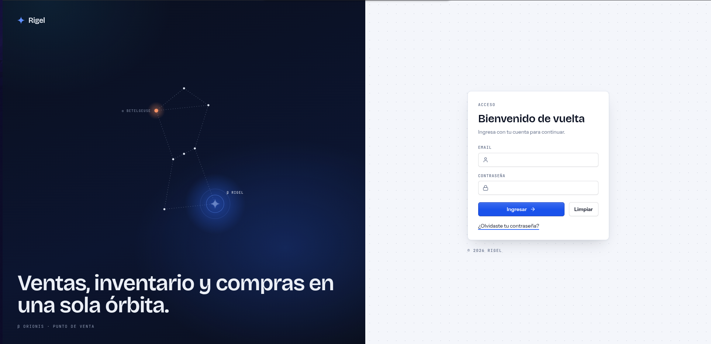
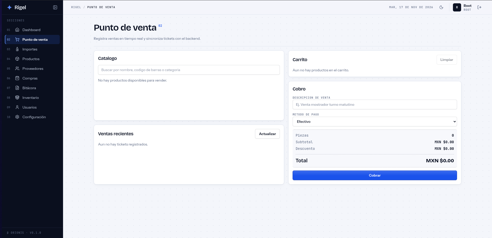

# Rigel Collection

> Modular business management software for small businesses — inventory, sales, and operational control.

Rigel Collection consolidates and reimagines several previous iterations built during my learning process,
this time with a clear architecture and a long-term roadmap.

---

## Modules

| Module          | Tech                        | Status   |
|-----------------|-----------------------------|----------|
| `rigel`         | Spring Boot + Kotlin        | Active   |
| `rigel_dream`   | React + TypeScript          | Active   |
| `rigel_android` | Jetpack Compose (+ KMP TBD) | Refactor |

---

## Architecture

```
┌─────────────────────────────────────────┐
│              rigel_dream                │
│           (React + TypeScript)          │
│         Web frontend · Port 5173        │
└────────────────────┬────────────────────┘
                     │ REST API
┌────────────────────▼────────────────────┐
│                  rigel                  │
│          (Spring Boot + Kotlin)         │
│            Backend · Port 8080          │
│                                         │
│  ┌──────────┐  ┌──────┐  ┌──────────┐   │
│  │Inventory │  │Sales │  │  Image   │   │
│  │ Module   │  │Module│  │ Service  │   │
│  └──────────┘  └──────┘  └────┬─────┘   │
└───────────────────────────────┼─────────┘
          ┌──────────┐          │
          │PostgreSQL│    ┌─────▼──────┐
          │    DB    │    │ Cloudinary │
          └──────────┘    └────────────┘
```

---

## Screenshots
 
 
---

## Tech Stack

**Backend (`rigel`)**

- Kotlin + Spring Boot
- PostgreSQL
- Cloudinary (image storage)
- Docker

**Frontend (`rigel_dream`)**

- React + TypeScript
- Vite

**Planned**

- Jetpack Compose (Android)
- Kotlin Multiplatform (KMP)

---

## Getting Started

### Prerequisites

- Java 21+
- Node.js 22+
- PostgreSQL instance (local or remote)
- A Cloudinary account (optional — falls back to local storage)

### Backend (`rigel`)

```bash
cd rigel
./gradlew build bootRun
```

The server starts on `http://localhost:8080`.

### Frontend (`rigel_dream`)

```bash
cd rigel_dream
npm install
npm run dev
```

The app starts on `http://localhost:5173`.

### Docker (database + backend + frontend)

```bash
cp .env.example .env          # set DB_PASSWORD and JWT_SECRET (openssl rand -base64 48)
docker compose up -d --build
```

| Service    | Image                | URL                     |
|------------|----------------------|-------------------------|
| `frontend` | nginx + Vite build   | `http://localhost:5173` |
| `backend`  | Spring Boot (JRE 21) | `http://localhost:8080` |
| `db`       | PostgreSQL 17        | internal only           |

The frontend container proxies `/api/*` to the backend, so the browser only talks to one origin.
Database data and locally stored product images live in the `db-data` and `uploads` volumes.

### Sharing on the local network

- **Docker:** open `http://<this-machine-ip>:5173` from any device on the network. Set
  `ORIGIN` in `.env` to that URL so the links sent by email point to it.
- **Without Docker:** start the backend with `CORS_LOCAL_NETWORK=true` (accepts browser origins from
  `192.168.0.*`; change the range with `CORS_LOCAL_NETWORK_PATTERNS`), and the frontend with
  `VITE_API_BASE=http://<this-machine-ip>:8080 npm run dev -- --host`.

### JAR (standalone)

```bash
cd rigel
./gradlew clean build
java -jar build/libs/Rigel-*.jar
```

---

## Configuration

The backend reads its settings from environment variables (defaults are meant for local development):

| Variable                                                               | Default                                     | Purpose                                              |
|------------------------------------------------------------------------|---------------------------------------------|------------------------------------------------------|
| `DB_URL`, `DB_USERNAME`, `DB_PASSWORD`                                 | `jdbc:postgresql://localhost:5432/rigel_db` | PostgreSQL connection                                |
| `JWT_SECRET`                                                           | development key                             | Base64 HMAC key, at least 32 bytes                   |
| `ORIGIN`                                                               | `http://localhost:5173`                     | Frontend URL: CORS origin and base of emailed links  |
| `CORS_LOCAL_NETWORK`                                                   | `false`                                     | Also accept browser origins from the local network   |
| `CORS_LOCAL_NETWORK_PATTERNS`                                          | `http://192.168.0.*:[*]`                    | Comma-separated origin patterns for the option above |
| `EMAIL_HOST`, `EMAIL_PORT`, `EMAIL_ADDRESS`, `EMAIL_PASSWORD`          | empty                                       | SMTP (optional)                                      |
| `CLOUDINARY_CLOUD_NAME`, `CLOUDINARY_API_KEY`, `CLOUDINARY_API_SECRET` | empty                                       | Image hosting (optional)                             |
| `IMAGE_STORAGE_PATH`                                                   | `./uploads`                                 | Local image folder when Cloudinary is not set        |

> If Cloudinary credentials are absent or blank, the service falls back to local disk storage automatically.

---

## Roadmap

### v0.1 · Foundation

- [x] Product inventory (CRUD)
- [x] Image upload with Cloudinary + local fallback
- [x] Supplier management
- [x] Sales module (basic)

### v0.2 · Operational control In progress

- [ ] Low stock alerts
- [ ] Sales history and reports
- [x] Role-based access (admin / employee)

### v0.3 · Mobile In progress

- [ ] Android app (`rigel_android`) with Jetpack Compose
- [ ] Evaluate Kotlin Multiplatform for shared business logic

---

## Contributing

Contributions are welcome. Fork the repo, make your changes, and open a pull request.
For significant changes, opening an issue first to discuss the approach is appreciated.

---

## License

This project is licensed under the [MIT License](LICENSE).